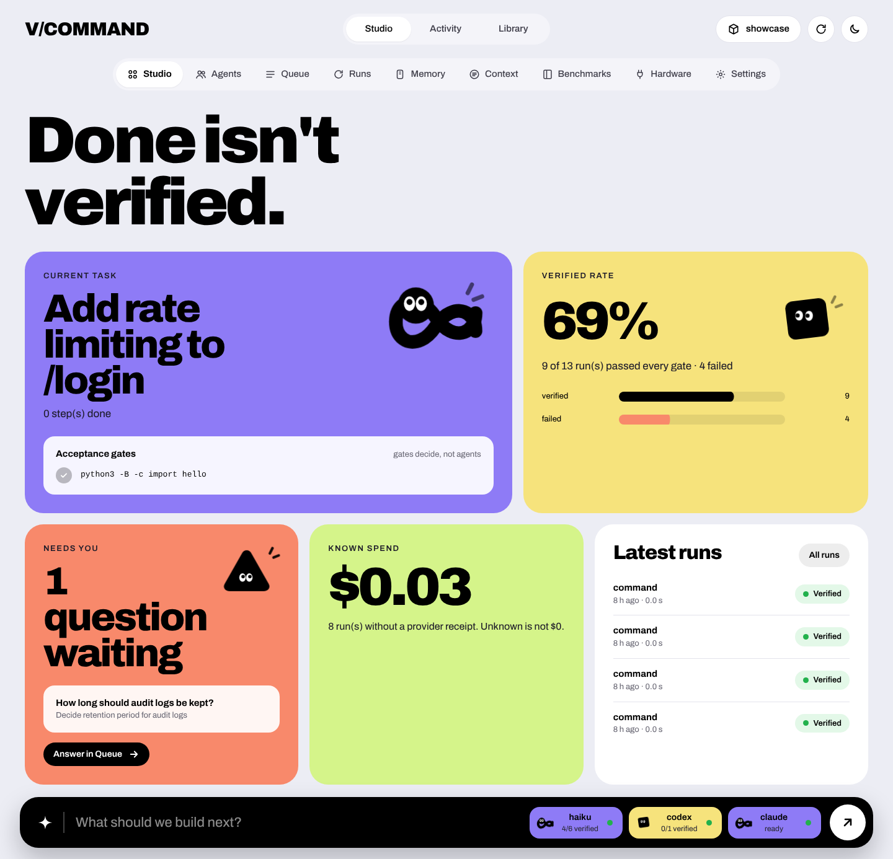
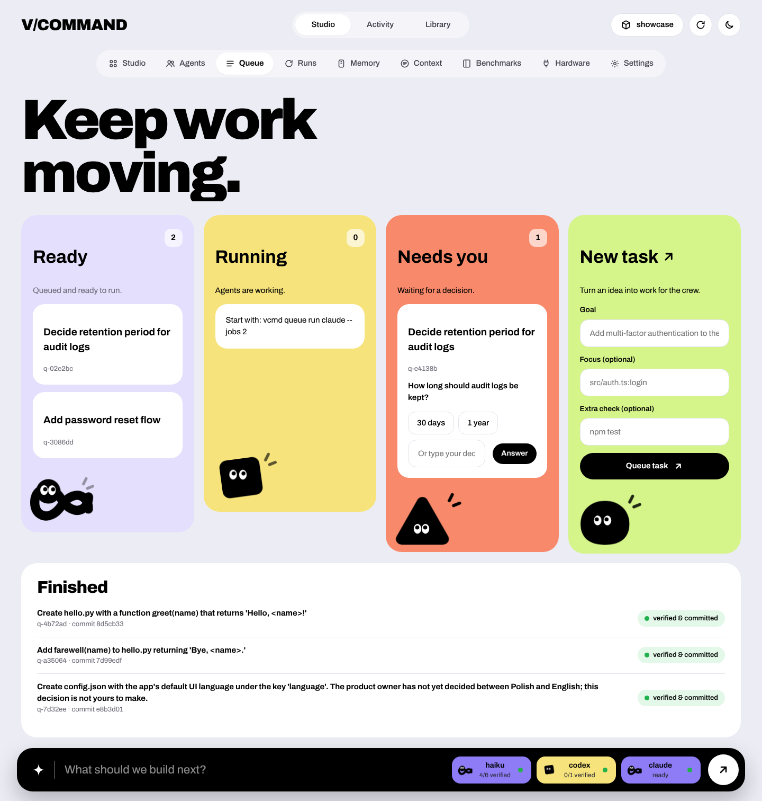
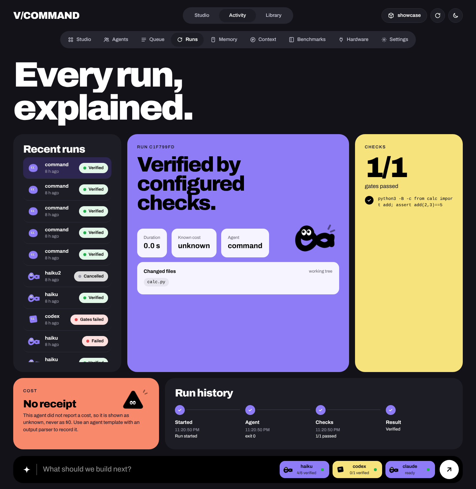

# V/COMMAND

**Your agents. Under control.**

> Open-source, terminal-first execution evidence for AI coding agents.
>
> **Alpha:** real execution, verification checks, local evidence, and task handoff between agents (Claude Code, Codex CLI). No model routing or provider cost tracking yet.


**Done isn't verified.** Run it yourself: `vcmd demo` (scripted agents, real files, checks and ledger; regenerate the recording with `python scripts/render_demo_svg.py`).

## Why

AI coding agents are useful, but "task completed" is not evidence the change works. Developers also need transparent cost accounting and continuity across models. V/COMMAND starts with independent verification and truthful, local evidence reports. Future releases can add opt-in provider adapters, memory, handoffs, routing and budgets.

## Current features (0.1.0-alpha)

- Run a user-supplied command **without a shell**; output stays in your terminal.
- Configure verification commands and automatically execute them after a successful task command.
- Store each run's status, check results, timing and optional Git *status snapshots* locally as JSON.
- Distinguish `unverified`, `verified_by_configured_checks`, `failed`, and `failed_verification`.
- View reports in human-friendly CLI or machine-readable JSON.
- Save a work-mode preference (`speed`, `balanced`, `offline`); **this does not yet route models or enforce offline isolation**.
- **Model-independent task state:** `vcmd task` keeps the goal, completed steps and next step on disk, outside any chat session.
- **Negative knowledge ledger:** failed runs are recorded automatically (`vcmd run --agent … --note …`), so the next agent is told what already failed. Command output is never stored.
- **Context frame handoff:** `vcmd frame` compiles goal, progress, hard constraints, acceptance gates and repo state into a compact prompt (or `--json`) for *any* agent or model, with a continuity token.
- **Agent adapters:** `vcmd hooks install claude` (or `codex`) injects the frame into every agent session (start, resume, `/clear`, compaction) and blocks the agent from finishing while your checks fail. `vcmd agent codex claude` runs agents non-interactively and hands the task to the next one when gates fail; `--isolate` gives every attempt its own git worktree and applies only verified changes.
- **Code slice:** `vcmd task focus src/auth.ts:AuthService.login` puts the focused code and its blast radius (tests, importers, callers) in the frame; **pre-flight warnings** come from counts in the ledger.
- **Failover, cost, budget:** agents whose provider fails are skipped for a cooldown; Claude Code's reported cost is recorded per attempt; `--budget` stops spending on a task.
- **Benchmark:** `vcmd bench` compares `agent:plain` vs `agent:frame` on a task suite (see [benchmarks/](benchmarks/README.md)). Measured on 200 TypeScript tasks with Claude Haiku: no pass-rate benefit from the frame so far (200/200 both ways, also after a failed first attempt) at +5–7% cost — published as measured.
- **Local backup and overnight queue:** `vcmd hw` recommends an Ollama model that fits your machine and registers it as a fallback agent; `vcmd queue` runs tasks overnight, commits only verified work and keeps questions for you.
- **Persistent workflow for every agent** ([docs/WORKFLOW.md](docs/WORKFLOW.md)): five-field operating brief (`vcmd task start --scope --constraint --done --leave-behind`); `handoff.md` (goal, state, files touched, open issues, next step) rewritten after every run, hook stop and compaction; `vcmd decide` / `vcmd todo`; deploys, publishing, database writes and bulk deletes need `vcmd approve` (PreToolUse hook + stream guard); `vcmd loop` runs planner → builder(s) → reviewer with the gates as judge; `vcmd wake` + `vcmd schedule cron|systemd|github` continue the work from a trigger.
- **Parallel sessions and reach** ([docs/WORKFLOW.md](docs/WORKFLOW.md#7-worktrees-not-chaos-one-isolated-workspace-per-live-session)): `vcmd worktree new <name>` gives every live session its own worktree with collision warnings; `vcmd sessions` / `vcmd msg send` let sessions talk; `vcmd agent --continue / --resume / --fork`; `vcmd roles` + `queue add --role`; Telegram / Slack / ntfy / webhook notifications, `vcmd remote telegram` to approve and steer from your phone, `vcmd autopilot` to keep waking the work.
- No API dependency, no background daemon, no telemetry, no cloud account.
- Python 3.10+, Windows/macOS/Linux intended; tested in CI matrix.

## Quick start

```bash
# At project root, with Python >= 3.10
python -m pip install -e .
vcmd doctor
vcmd demo
vcmd init
vcmd check add -- python -m unittest discover -s tests
vcmd run -- python -c "print('agent completed')"
vcmd evidence
vcmd evidence --json
vcmd mode offline
vcmd cost
```

### Hand a task to another agent or model

```bash
vcmd task start "Fix login and add password reset"
vcmd task done "Zod schema for /auth/reset"
vcmd task next "Invalidate Redis sessions in confirmPasswordReset"
vcmd run --agent model-a --note "jwt.destroy() in controller" -- <agent command>
vcmd ledger add --tried "reorder session middleware" --why "session.spec race" --agent model-a
vcmd frame --out handoff.md     # give this to model B, from any provider
```

### Let agents pick it up automatically

```bash
vcmd hooks install claude      # Claude Code: frame at session start, checks at Stop
vcmd hooks install codex       # Codex CLI: same, after trusting the hooks via /hooks
vcmd agent codex claude        # Codex first; on failed gates hand off to Claude
vcmd agent codex claude --isolate   # each attempt in its own git worktree; only verified work lands
vcmd agent --race claude codex      # all at once; first verified wins, the rest are killed
```

Details: [docs/ADAPTERS.md](docs/ADAPTERS.md).

### Dashboard and API keys

```bash
vcmd dashboard                   # opens http://127.0.0.1:<port>/?token=… in your browser
vcmd dashboard --background      # detached; prints the URL (vcmd dashboard --stop)
vcmd dashboard --install-command # /dashboard inside Claude Code (also added by `vcmd hooks install claude`)
vcmd secret set OPENAI_API_KEY   # or add keys on the dashboard's "API keys" tab
```



| Queue | Runs (dark) |
|---|---|
|  |  |

Nine views — Studio, Agents, Queue, Runs, Memory, Context, Benchmarks, Hardware, Settings — all built
from real project data. Type a goal in the bottom bar to queue it. Each agent has an animated character
(builder, checker, challenger, advisor) that blinks, breathes, follows your cursor and reacts to state:
working agents move faster, a question waiting for you makes one fidget, a paused provider looks down.
Motion uses transform/opacity only, view transitions between tabs, and respects reduced motion.
Light and dark, works on a phone; the Archivo font (OFL) ships with the package, so nothing is loaded
from the internet.

- **Keys are secrets.** Stored in macOS Keychain, Windows DPAPI (encrypted for your user), Linux Secret
  Service, or — if none is available — `~/.config/vcommand/secrets.json` with permissions 0600 (shown as
  "not encrypted"). Values are never shown again or sent to the page; you see `sk-…abcd`. They are
  passed only to agents V/COMMAND starts; a variable already set in your shell wins. Storing
  `ANTHROPIC_API_KEY` switches Claude Code to API billing for those agents.
- **Local only.** Binds to 127.0.0.1, every request needs the random token from the URL, the Host header
  must be loopback (DNS-rebinding protection), actions accept JSON only.

### Brief, roles, guardrails, triggers

```bash
vcmd task start "Add password reset" --scope "src/auth/*" --constraint "no new deps" --done "npm test passes"
vcmd loop --plan claude --build claude --build codex --review codex   # plan -> build/test -> review
vcmd approve                     # risky commands agents asked to run (deploy, DB write, bulk delete)
vcmd handoff                     # 1 goal  2 state  3 files touched  4 open issues  5 next step
vcmd schedule github claude --loop --write   # nightly / webhook wake-up; verified work lands on a branch
vcmd worktree new auth && vcmd worktree new ui   # one session per worktree; vcmd worktree conflicts
vcmd msg send ui "Auth flow updated, please review refresh logic"
vcmd channel add telegram --chat 123456789 && vcmd autopilot claude --every 30m --remote
```

### Overnight queue

```bash
vcmd hw                          # what can this machine run locally?
vcmd hw --add-agent local        # register codex --oss + Ollama as a free fallback
vcmd queue add "Add rate limiting to /login" --focus src/auth.ts:login --gate "npm test"
vcmd queue add "Document the new limit" --after q-xxxxxx
vcmd queue run claude local --jobs 3 --until 07:00 --budget 1.50
vcmd queue report                # committed / failed / waiting for your decision
vcmd queue answer q-yyyyyy "Use 5 attempts per minute"
```

`.vcommand/task.json` and `.vcommand/ledger.jsonl` are plain files: commit them to share project memory with your team, or keep them ignored.

**Note:** The example shows an actual Python command, not an LLM integration. Replace it with your existing trusted agent command (e.g. any executable available in PATH). Commands are executed with *your* current OS permissions. Do not run untrusted tools.

### Typical workflow

```bash
vcmd init
vcmd check add -- npm test
vcmd run -- npm run build
vcmd evidence --json
```

The resulting JSON is stored in `.vcommand/runs/` (should be Git-ignored). It is not cryptographically tamper-proof. Verification means only the *configured checks* passed; it does **not** prove the software correct or secure.

## What this alpha does NOT do

| Capability | Status |
|---|---|
| Existing command execution | Implemented |
| Configurable post-run checks | Implemented |
| Local Evidence Report | Implemented |
| Git status before/after (not causal attribution) | Implemented |
| Claude Code and Codex CLI hooks (frame injection, gate at Stop) | Implemented |
| Non-interactive agent wrapper with handoff (Codex CLI, `claude -p`, custom) | Implemented |
| Per-attempt git worktree isolation (`--isolate`) | Implemented |
| Manual cross-agent handoff (context frame + ledger) | Implemented |
| Provider failover (circuit breaker), cost from Claude Code, budget | Implemented |
| OpenCode adapter | Implemented (`opencode run`) |
| Code slice + blast radius in the frame | Implemented (Python `ast`; TS/JS tree-sitter with `[ast]`, scanner otherwise) |
| Benchmark harness + 200-task TypeScript suite + handoff arms | Implemented (`vcmd bench`, `benchmarks/ts200`) |
| Race mode (parallel candidates, first verified wins) | Implemented (`vcmd agent --race`) |
| Stream guard (kill on banned pattern mid-attempt) | Implemented (Claude Code stream-json) |
| Hardware probe, local backup agent, overnight queue | Implemented (`--jobs N` parallel workers) |
| Automatic model routing by task difficulty | Not implemented |
| Cost for Codex CLI | Token usage recorded; USD as a labelled estimate from configured prices |
| True air-gapped offline enforcement | Not implemented |
| Local semantic memory / savings measurements | Planned |
| Auto-repair on failed verification | Planned |
| Local web dashboard + API keys in the OS secret store | Implemented (`vcmd dashboard`, `/dashboard`, `vcmd secret`) |
| Operating brief, handoff.md / decisions.md / todo.md, diff in evidence | Implemented (`vcmd task brief`, `vcmd handoff`, `vcmd decide`, `vcmd todo`) |
| Approval for deploy / publish / DB write / bulk delete | Implemented (pattern-based PreToolUse hook + stream guard; not a sandbox) |
| Role loop (plan → build → review) and trigger wake-up | Implemented (`vcmd loop`, `vcmd wake`, `vcmd schedule`) |
| Worktree per session, collision warnings, session registry and messages | Implemented (`vcmd worktree`, `vcmd sessions`, `vcmd msg`) |
| Continue / resume / fork agent sessions | Implemented (Claude Code; Codex resume only) |
| Channels and remote control | Implemented (Telegram, Slack, ntfy, webhook; Telegram commands; `vcmd autopilot`) — real services not tested from CI |
| Advanced TUI and IDE companions | Planned |

## Project principles

1. **Terminal-first**: works in PowerShell, Warp, Ghostty, Windows Terminal, VS Code integrated terminals and others.
2. **Evidence, not decoration**: clear status backed by checks.
3. **Unknown is not zero**: do not invent money saved, model cost, or errors prevented.
4. **User sovereignty**: local by default; no forced cloud, account or subscription.
5. **Provider-neutral**: no special dependency on one model or coding agent.

## Documentation

- [Full product concept (Polish)](docs/CONCEPT_PL.md)
- [Architecture and evidence contract](docs/ARCHITECTURE.md)
- [Agent adapters (Claude Code, Codex CLI)](docs/ADAPTERS.md)
- [Persistent workflow: brief, handoff, guardrails, roles, triggers](docs/WORKFLOW.md)
- [Execution Kernel: stateless models, context frames, roadmap](docs/EXECUTION_KERNEL.md)
- [MVP acceptance criteria](docs/MVP.md)
- [Milestones and GitHub issues](docs/ROADMAP.md)
- [Open-source launch and branding](docs/LAUNCH.md)
- [Security](SECURITY.md)
- [Contributing](CONTRIBUTING.md)

## License

MIT — free to use, fork, modify and redistribute. Running paid model APIs still incurs providers' normal charges; V/COMMAND itself is free.

## Prior art / competition

See [competitive notes](docs/COMPETITION.md). Existing model routers and agents are important complements, not claims of invention.
