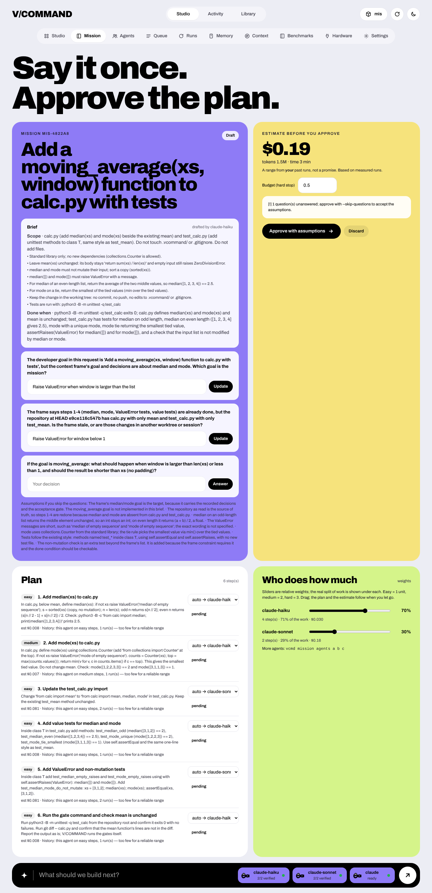

# Mission — say it once, approve the plan, see the cost before it runs



```bash
vcmd roles set plan claude-haiku                  # who drafts the brief (read-only); optional
vcmd mission new "Add password reset" --agents claude-haiku claude-sonnet codex
vcmd mission                                       # plan, who does what, estimate
vcmd mission answer 1 "Tokens expire after 30 min" # the enhancer asks instead of guessing
vcmd mission share claude-haiku=70 claude-sonnet=30   # sliders (or drag them in the dashboard)
vcmd mission pin 3 codex                           # force one step onto one agent
vcmd mission budget 2.50                           # hard stop; --agent NAME for a per-agent cap
vcmd mission approve                               # nothing runs before this
vcmd mission run                                   # step by step, gates after every step
vcmd mission report                                # estimate vs actual
```

The dashboard has the same flow (Mission tab): type the goal, answer the questions, drag the sliders —
the plan and the estimate recompute when you let go — set the budget, approve, run, watch the steps.

## What each part really does

**Enhancer (optional).** One agent, read-only, turns the sentence into a brief (scope, constraints, done
condition), up to five questions only you can answer, the assumptions it would otherwise make, and 1–8
verifiable steps tagged easy / medium / hard. It never guesses silently: ambiguity becomes a question *and* an
explicit assumption. Answers become constraints in the brief; unanswered questions are approved as stated
assumptions (`--skip-questions`) or not at all. One automatic retry if the reply is not valid JSON; if it
still fails, the goal becomes a single step (the mission still works).

**Sliders.** Relative weights, not tokens: a model does whole steps, so the share of work is measured in
units (easy 1, medium 2, hard 3). The hardest steps are assigned first, each to the agent furthest below its
target. Pinned steps are fixed first. Per-agent caps (USD) hand the remaining steps to the next agent.

**Estimate.** A range (low / typical / high) of cost, tokens and time, computed from **your own history**:
mission runs of that agent on steps of that difficulty, then all its past runs (provider-reported cost and
tokens in the evidence). It says how many runs the range rests on and flags fewer than four as unreliable.
With no data for an agent it says "no data" — unknown is not zero. You can state an assumption yourself
(`"mission": {"assume": {"codex": {"usd_per_step": 0.25}}}` in the config); it is labelled as one. The first
mission with an agent builds its history. An estimate is not a promise: the budget is the guarantee.

**Run.** Each step goes to its agent with the brief, the frame and the step's instruction; the acceptance
gates run after every step (the gates judge, not the agent); a failing step falls back to the other agents
of the mission, then stops with a handoff. The report lists estimate vs actual per step. `--review` asks the
`review` role for a verdict at the end. Channels (Telegram, Slack, …) are notified when it finishes.

## Measured (and what it means for the enhancer)

From `benchmarks/results/vague10-haiku-sonnet.md` (10 tasks, one-sentence goals, hidden conventions in each
repo's README; 2 repeats; live Claude Code):

| Arm | Pass rate | Cost per verified task |
|---|---|---|
| haiku, bare goal | 20/20 | $0.006 |
| haiku, enhancer brief | 20/20 | $0.013 |
| sonnet, bare goal | 13/20 | $0.124 |
| sonnet, context frame | 19/20 | $0.098 |
| sonnet, enhancer brief | 18/20 | $0.173 |

* The frame lifted Sonnet from 65% to 95% (p = 0.044, small suite — a lead, not proof).
* **The enhancer did not raise the pass rate above the frame and costs about twice as much.** Use it when you
  want the questions, the plan and the brief in front of you before spending money; leave it off for
  routine tasks. Mission works without it.
* On these easy, self-contained tasks the cheap model was both cheaper (~16x per verified task) and at least
  as good — the case for routing by difficulty. Harder, multi-file work has not been measured yet.

## Limits

* Estimates need history; the first mission with a new agent shows "no data".
* Step costs vary a lot; the typical value of three runs is not a forecast. Use the budget.
* Steps run one after another in one working tree; parallel steps are not implemented.
* Codex cost is a token-based estimate only when you configure prices (see ADAPTERS.md).
