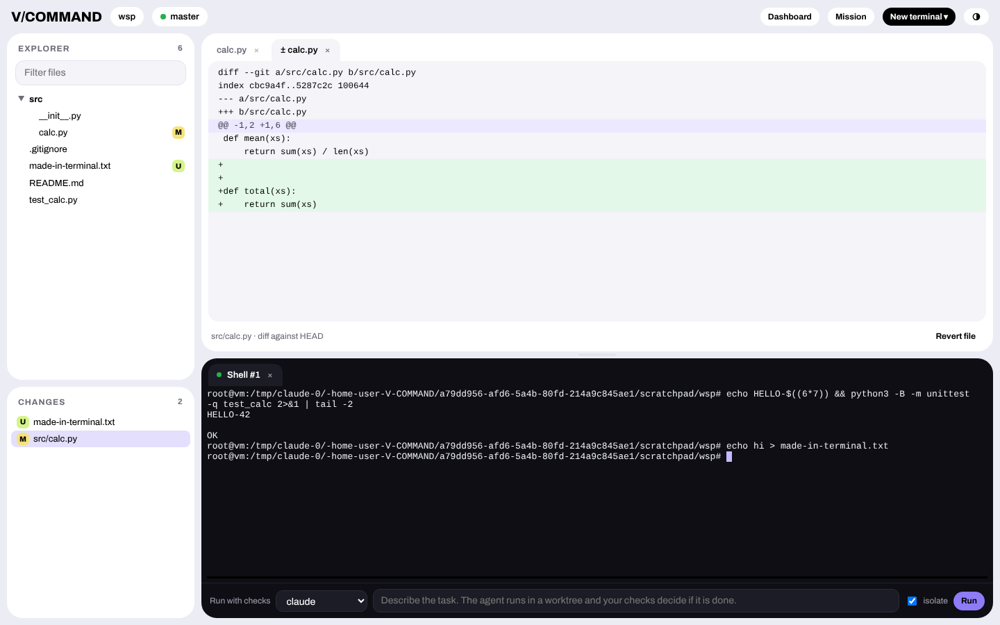
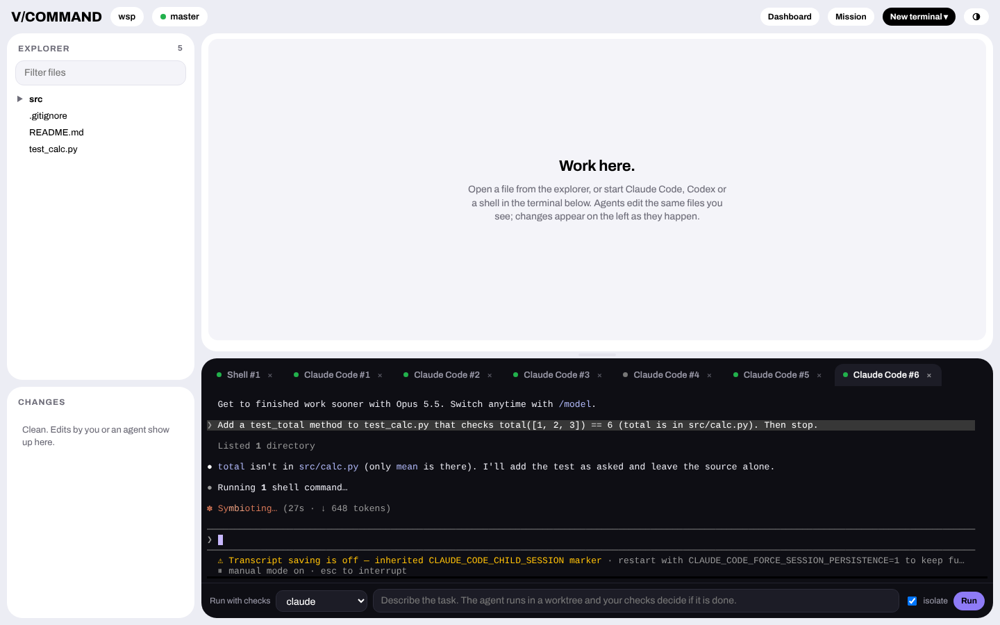

# Workspace — work and code inside V/COMMAND

```bash
vcmd workspace          # opens http://127.0.0.1:<port>/workspace?token=…
```



A local, single-page workspace in your browser — no cloud, no account:

* **Real terminals.** Every tab is a pseudo-terminal (xterm.js in the page, a PTY on your machine): a shell,
  **Claude Code**, **Codex**, **OpenCode** or your own profile. Full-screen TUIs work. Tabs survive a page
  reload and can run side by side; pick a worktree (`vcmd worktree new …`) to start an agent in it.
* **Files and editor.** File tree, filter, tabs, line numbers, Tab key, `Ctrl/Cmd+S`. A save is atomic and
  **refuses to overwrite a file that changed on disk** after you opened it (an agent or another tool wrote it):
  you choose *Reload* or *Overwrite*. Open, unmodified files refresh by themselves when an agent writes them.
* **Changes.** Everything modified or created — by you, by an agent in any terminal — shows up with a
  diff against HEAD and a *Revert file* button (restore from HEAD, or delete if untracked).
* **Run with checks.** The bar under the terminal runs `vcmd agent <agent> --instruction "…"` (optionally
  `--isolate`) in a new tab: your acceptance gates decide whether it is done, with handoff, ledger and
  failover as usual. Interactive sessions get the same hooks if you ran `vcmd hooks install claude|codex`
  (frame at start, gates at stop, risky commands need approval, live session registry and messages).
* **Neighbours.** *Dashboard* and *Mission* links in the header; the dashboard's *Workspace* button opens it.

Verified in a real browser against Claude Code 2.1.316: the TUI (theme picker, trust prompt, tool use, its own
permission dialog) renders and takes input in a tab; a file created in a shell tab appears in *Changes* within
seconds; a save conflicts correctly when the file changed underneath.



## Security — read this

A terminal is a shell on your machine. Therefore:

* **Opt-in.** The terminal and the file editor exist only when you start `vcmd workspace`; the plain dashboard
  (`vcmd dashboard`, `/dashboard`) never offers them (the endpoints answer 403).
* Loopback only (`127.0.0.1`), a random token in the link, the `Host` header must be loopback (DNS rebinding),
  JSON-only POSTs, and **any request carrying a foreign `Origin` is rejected** — a web page you visit cannot
  drive the shell even if it learned the token. **Anyone who has the link can run commands as you: keep it
  private** (it is not logged; stop the server with Ctrl+C, which also ends every terminal).
* Files: every path is resolved and must stay inside the project (no `..`, no symlink escapes), `.git` is
  off limits, text files up to 1 MB. This protects the editor; it is **not** a sandbox for what you or an
  agent runs in a terminal.
* Agent tabs receive your stored API keys (or only those named in the profile's `"secrets"`), a plain shell tab
  does not; channel tokens (Telegram, Slack) never reach any terminal. Parent-session variables
  (`CLAUDE_CODE_SESSION_ID`, `CLAUDE_CODE_CHILD_SESSION`, …) are removed so a child agent starts its own
  session — found live: the inherited marker silently switched off its transcript saving.

## Limits (honest list)

* **Windows:** Python's standard library has no pseudo-terminal there, so tabs are pipe-based consoles:
  line-oriented programs work, full-screen TUIs (Claude Code, Codex) do not. Use macOS, Linux or WSL.
  A ConPTY backend is future work.
* The editor is a plain text area: no syntax highlighting, completion or language server. Agents and your
  own tools do the heavy lifting; this is for reading, reviewing and fixing.
* One browser tab per workspace is the tested case; terminal output is kept in a 1 MB ring buffer per tab.
* Not a replacement for an IDE; it is the place where agents, checks, missions and your hands meet.

Custom profiles (`.vcommand/config.json`):

```json
"terminal": {"profiles": [{"name": "aider", "argv": ["aider", "--yes"], "secrets": ["OPENAI_API_KEY"]}]}
```
